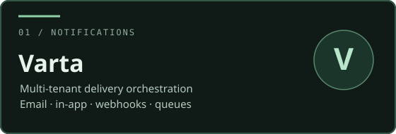
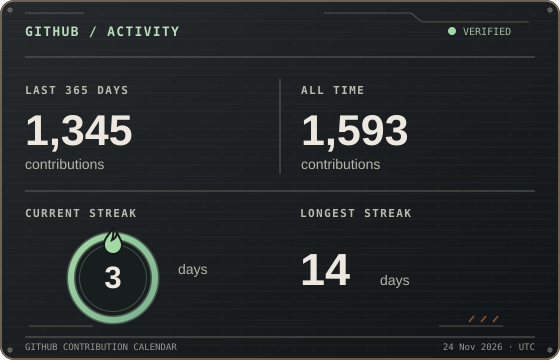

  
   
  <b>B.E. Information Science &amp; Engineering</b>
    
  
  
  

### TOOLCHAIN

**Languages**

**Development**

**Data**

**Infrastructure**

**Core**

`DSA` `Operating Systems` `DBMS` `Computer Networks` `System Design`

### WORKS

  
  
   
  
  

### STATS

  

### ARCADE

  <picture>
    <source media="(prefers-color-scheme: dark)" srcset="./assets/snake-sage-dark.svg"/>
    <source media="(prefers-color-scheme: light)" srcset="./assets/snake-sage-light.svg"/>
    
  </picture>

