  
   
  <b>B.E. Information Science &amp; Engineering</b>
    
  
  
  

- Building **backend infrastructure** and exploring **distributed systems**.
- Practising **DSA** on **LeetCode** and **CodeChef**.
- Learning through **storage engines**, **developer tools**, and real-world projects.

## TOOLCHAIN

**Languages**

  
  
  

C++ · TypeScript · JavaScript · SQL

**Development**

  
  
  
  

Node.js · Express · Next.js · Tailwind CSS

**Backend & messaging**

  
  
  
  

JWT · OAuth 2.0 · RBAC · BullMQ · Kafka · Webhooks

**Data**

  
  
  
  

PostgreSQL · Prisma · MongoDB · Redis

**Infrastructure**

  
  
  
  
  

Docker · Linux · GitHub Actions · Prometheus · Grafana

**Core**

`DSA` `Operating Systems` `DBMS` `Computer Networks` `System Design`

## WORKS

  
  
   
  
  

## ACTIVITY

  
   
  

## CONTRIBUTION

  <picture>
    <source media="(prefers-color-scheme: dark)" srcset="./assets/snake-sage-dark.svg"/>
    <source media="(prefers-color-scheme: light)" srcset="./assets/snake-sage-light.svg"/>
    
  </picture>

