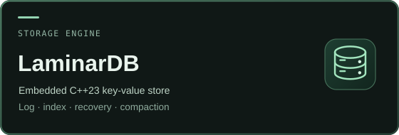
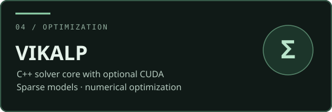

 

**Building backend systems, distributed infrastructure, and developer tools.**

B.E. Information Science & Engineering · Bengaluru, India

---

### 01 / Engineering dashboard

  
  

Stats reflect data exposed by GitHub and the external widget providers. Private contributions, caches and API limits may affect displayed counts.

### 02 / Toolchain

  

More about the stack

**Backend** — Node.js · Express · REST · WebSockets · SSE · BullMQ · JWT · OAuth

**Data** — PostgreSQL · Prisma · MongoDB · Redis

**Infrastructure** — Docker · Compose · Linux · GitHub Actions · Prometheus · OpenTelemetry

**Computer science** — DSA · operating systems · database systems · networking · distributed systems

### 03 / Contribution arcade

  <picture>
    <source media="(prefers-color-scheme: dark)" srcset="./assets/snake-sage-dark.svg"/>
    <source media="(prefers-color-scheme: light)" srcset="./assets/snake-sage-light.svg"/>
    
  </picture>

Generated from the GitHub contribution calendar by [Platane/snk](https://github.com/Platane/snk). The preview branch generates the assets on its first workflow run; no made-up contribution numbers are embedded.

### 04 / Selected work

<table>
<tr>
<td width="50%"></td>
<td width="50%"></td>
</tr>
<tr>
<td width="50%"></td>
<td width="50%"></td>
</tr>
</table>

Also built: [Chronix](https://github.com/imsayon/chronix), a distributed scheduler and webhook delivery control plane.

---

imsayon · systems over slogans · keep building

