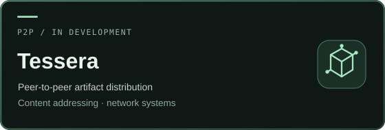
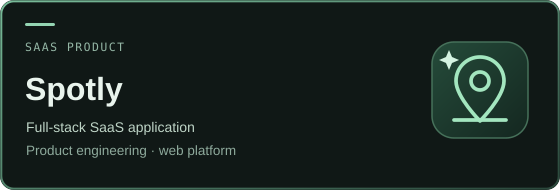
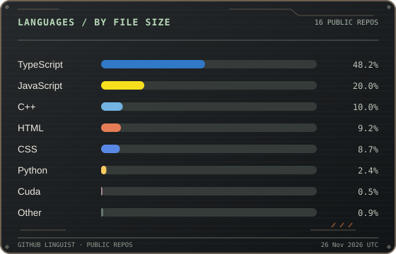

  
   
  <b>B.E. Information Science &amp; Engineering</b>
    
  
  
  

- Building **backend infrastructure** and exploring **distributed systems**.
- Practising **DSA on LeetCode** and **competitive programming on CodeChef**.
- Exploring **API engineering**, **event-driven messaging**, **reliable job processing**, and **storage-engine internals** through real-world projects.

## TOOLCHAIN

<table width="100%">
<tr>
  <td width="50%" valign="top">
    <strong>Languages</strong>
    

  
  
  

C++ · TypeScript · JavaScript · SQL
  </td>
  <td width="50%" valign="top">
    <strong>Development</strong>
    

  
  
  
  

Node.js · Express · Next.js · Tailwind CSS
  </td>
</tr>
<tr>
  <td width="50%" valign="top">
    <strong>Backend &amp; messaging</strong>
    

  
  
  
  

JWT · OAuth 2.0 · RBAC · BullMQ · Kafka · Webhooks
  </td>
  <td width="50%" valign="top">
    <strong>Data</strong>
    

  
  
  
  

PostgreSQL · Prisma · MongoDB · Redis
  </td>
</tr>
<tr>
  <td width="50%" valign="top">
    <strong>Infrastructure</strong>
    

  
  
  
  
  

Docker · Linux · GitHub Actions · Prometheus · Grafana
  </td>
  <td width="50%" valign="top">
    <strong>Core</strong>
    
<code>DSA</code> <code>Operating Systems</code> <code>DBMS</code> <code>Computer Networks</code> <code>System Design</code>

  </td>
</tr>
</table>

## WORKS

  <a href="https://github.com/imsayon/tessera">
  
   
  
  

## ACTIVITY

  
  

## CONTRIBUTION

  <picture>
    <source media="(prefers-color-scheme: dark)" srcset="./assets/snake-sage-dark.svg"/>
    <source media="(prefers-color-scheme: light)" srcset="./assets/snake-sage-light.svg"/>
    
  </picture>

