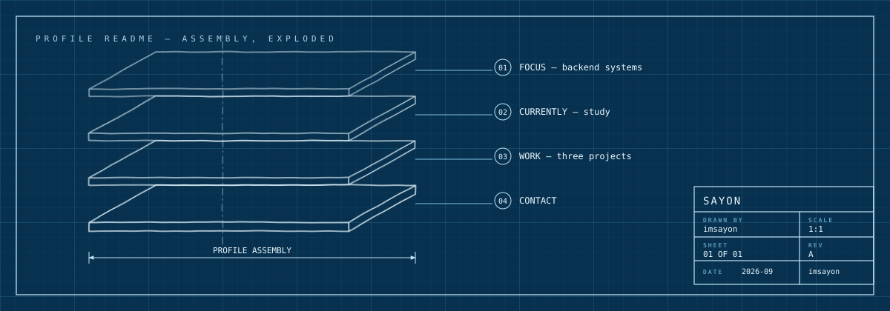

  

### 01 — focus

Backend-focused developer interested in distributed systems, GenAI, DevOps, and open source. Focused on building scalable, production-grade backend systems. Interested in contributing to and building open-source projects.

### 02 — currently

Practicing DSA and competitive programming. Exploring system design, cloud infrastructure, observability, and AI-powered systems.

### 03 — work

- **[Cronix](https://github.com/imsayon/chronix)** — distributed cron scheduling system.
- **[Varta](https://github.com/imsayon/varta)** — notification infrastructure with queues, workers, AI orchestration, and observability.
- **[Laminardb](https://github.com/imsayon/laminar-db)** — LSM-tree based key-value storage engine in C++.

Technical stack

**Languages** 
C++ · JavaScript · TypeScript · Python · SQL

**Backend** 
Node.js · Express.js · REST APIs · JWT · OAuth 2.0 · Webhooks · SSE · WebSockets

**Database & Storage** 
PostgreSQL · Prisma · pgvector · MongoDB · Mongoose · Redis · Firebase · Supabase

**Infrastructure & DevOps** 
Docker · Docker Compose · GitHub Actions · CI/CD · Prometheus · Grafana · Nginx

**GenAI & Observability** 
RAG Pipelines · LangChain · OpenTelemetry · Vector Search · Embeddings

**Systems** 
Linux · Fedora Linux · Bash

**Developer Tools** 
Git · GitHub · VS Code · Postman

Coursework

Data Structures & Algorithms · Operating Systems · Database Management Systems · Computer Networks · Object-Oriented Programming · Compiler Design

### 04 — contact

[Email](mailto:sayn731@gmail.com) · [LinkedIn](https://www.linkedin.com/in/sayon-m-7682b1220/) · [GitHub](https://github.com/imsayon)
